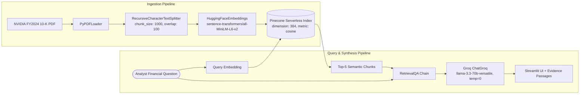

# Financial Analyst RAG — SEC 10-K Intelligence

> A specialized Retrieval-Augmented Generation assistant designed for **SEC Form 10-K annual report analysis**, powered by **LangChain**, **Pinecone vector database**, **HuggingFace MiniLM embeddings**, **Groq-accelerated LLaMA 3.3 70B**, and an interactive **Streamlit dashboard**.


[](https://www.linkedin.com/in/ankur-pal-2b2ba9433)

---

## Table of Contents
- [Overview](#overview)
- [Architecture Workflow](#architecture-workflow)
- [Key Features](#key-features)
- [Project Structure](#project-structure)
- [Quick Start](#quick-start)
- [Sample Queries & Analysis](#sample-queries--analysis)
- [License](#license)

---

## Overview

Corporate annual reports (SEC Form 10-K) span hundreds of pages with dense financial tables, GAAP/non-GAAP reconciliations, segment breakdowns, and critical risk factors. 

**Financial Analyst RAG** provides equity research analysts and investors with an automated question-answering pipeline that delivers strictly grounded numerical and qualitative answers directly from official 10-K disclosures, complete with exact source passage citations.

---

## Architecture Workflow



---

## Key Features

- **Strict Factual Accuracy:** Configured with `temperature=0` to eliminate hallucinations on earnings figures, revenue metrics, and operating expenses.
- **Source Grounding & Evidence Inspection:** Every answer includes an expandable passage inspector showing exact filing snippets and page numbers.
- **Ultra-Fast Inference:** Powered by Groq LPU inference for sub-second analysis generation on 70B parameter models.
- **Cost-Efficient Local Embeddings:** Utilizes `sentence-transformers/all-MiniLM-L6-v2` locally (zero embedding API cost, 384-dimensional dense vectors).
- **Interactive Streamlit Workspace:** Pre-loaded with quick question pills for instant evaluation of NVIDIA's Data Center growth, gross margins, and supply chain constraints.

---

## Project Structure

```
Financial-Analyst-RAG/
├── app.py               # Streamlit application with interactive UI
├── ingestion.py         # PDF parsing, chunking, embedding, and Pinecone upload
├── utils.py             # LangChain RetrievalQA chain with Groq Llama 3.3
├── requirements.txt     # Python dependencies
├── .env.example         # Environment template
└── data/
    └── nvidia_10k.pdf   # Sample NVIDIA FY2024 10-K filing (~1.2MB)
```

---

## Quick Start

### 1. Prerequisites
- Python 3.10 or higher
- Free Groq API Key ([console.groq.com](https://console.groq.com))
- Free Pinecone API Key & Index ([app.pinecone.io](https://app.pinecone.io))
  - When creating your index on Pinecone:
    - **Name:** `fin-analyst-index`
    - **Dimensions:** `384`
    - **Metric:** `cosine`

### 2. Environment Setup

```bash
# Clone the repository
git clone https://github.com/FresherMen/Financial-Analyst-RAG.git
cd Financial-Analyst-RAG

# Create virtual environment
python3 -m venv venv
source venv/bin/activate  # On Windows: venv\Scripts\activate

# Install requirements
pip install -r requirements.txt

# Configure environment variables
cp .env.example .env
# Edit .env and paste your GROQ_API_KEY and PINECONE_API_KEY
```

### 3. Ingest the 10-K Report

```bash
# Run the ingestion script (chunks the PDF and uploads vectors to Pinecone)
python ingestion.py
```

### 4. Launch the Streamlit App

```bash
streamlit run app.py
```
Open your browser at `http://localhost:8501`.

---

## Sample Queries & Analysis

Try asking:
- *"What was NVIDIA's total revenue in FY2024 and how does it compare to FY2023?"*
- *"What factors contributed to the growth in the Data Center segment?"*
- *"What are the primary risk factors regarding supply chain and wafer manufacturing?"*
- *"Summarize NVIDIA's gross margin performance and operating expenses in fiscal 2024."*

---

## Author & Connect

**Ankur Pal**  
- **LinkedIn:** [Ankur Pal](https://www.linkedin.com/in/ankur-pal-2b2ba9433)  
- **GitHub:** [@FresherMen](https://github.com/FresherMen)  
- **Portfolio:** [freshermen.github.io](https://freshermen.github.io)  

---

## License

This project is licensed under the MIT License.
